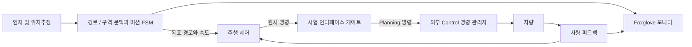
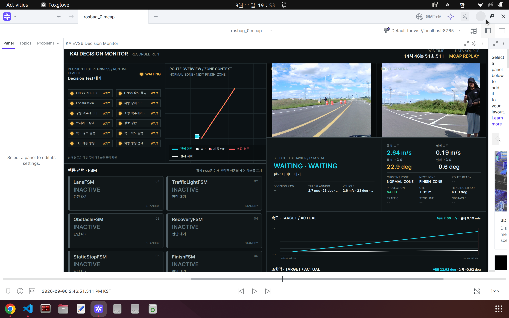

# 주행 판단과 차량 제어 — Team K.A.I.

**2026 대학생 AI·SW 모빌리티 경진대회 · ROS 2 Humble**

[English](README.md) · [프로젝트 포트폴리오](https://steveandy-sudo.github.io/projects/ai-sw-mobility/) · [실행 안내](docs/PORTFOLIO_SETUP.md)

자율주행 경진대회 차량의 경로 기반 판단, 경로 추종, 라바콘 제동 검차를 개발하는 프로젝트입니다. 판단·제어 구현과 함께 미션 상태, 목표 경로, 조향 명령, 차량 피드백을 관찰하는 도구를 정리했습니다.

| 기간 | 역할 | 팀 | 환경 |
| --- | --- | --- | --- |
| 2026년 3월–진행 중 | 황정헌 — 판단 | 전체 27명, 판단 파트 5명 | ROS 2 Humble · Gazebo · Foxglove |

## 결과와 현재 상태

| 환경 | 시험 조건 | 결과 |
| --- | --- | --- |
| 대회장 연습: 예선 코스 | 실차, **10 m/s(36 km/h)** | Waypoint 주행 성공 |
| 대회장 연습: 본선 코스 | 실차, **10 m/s(36 km/h)** | Waypoint 주행 성공 |
| 대회장 연습: AEB 정지 | 최대 **50 km/h**, 대회 요구 **30 km/h** | 빨간 콘 구간 시작점에서 제동, 구간 끝 이전 완전 정지 |
| 이전 Gazebo 개발 | AEB 폐루프 시험 | 시뮬레이션에서 파이프라인 연결 확인 |
| 오프라인 제어 검사 | 저장소 정리 시 [기존 AEB 테스트 29개 통과](docs/VALIDATION.md) | 기하 계산, 제동 로직, 시험 구성 및 패키지 구조 확인 |

최신 실차 시험은 주최 측이 대회장을 개방한 **2026년 9월 19–20일 연습 기간**에 수행했습니다. Waypoint 주행과 AEB 정지를 여러 차례 반복했습니다. 대회 공식 예선·본선 결과와 구분되는 연습 결과이며, 50 km/h는 AEB 시험 속도입니다.

AEB 성공 기준은 빨간 콘을 인지하여 구간 시작점에서 제동하고, 빨간 콘 구간이 끝나기 전에 완전히 정지하는 것입니다. [실험 기록](docs/EXPERIMENTS.md)에 이번 결과와 향후 정량 분석 항목인 정지 거리·경로 오차·조향 응답·반복성을 정리했습니다.

## 주요 개발 영역

- **주행 판단:** 경로·구역 문맥, 미션 상태 처리, 목표 경로와 속도 인터페이스.
- **경로 추종:** Stanley 제어, 조향각·변화율 제한, 차량 명령 처리와의 연동.
- **라바콘 AEB:** 경계 기반 중앙 경로, 빨간 진입선 정지, 입력 누락·지연 처리.
- **통합과 관찰:** Gazebo 개발, 대회장 반복 실차 연습, Foxglove를 이용한 실시간·기록 신호 확인.

## 시스템 구조

일반 주행 시험은 다음 흐름으로 구성됩니다.



이 시험 흐름에서는 시험 인터페이스가 `/decision/raw_command`를 받아 `/planning/command`의 발행을 담당합니다. 라바콘 AEB는 별도 시험 흐름으로 실행하며, 카메라–LiDAR 융합·카메라 단독 인지와 Pure Pursuit·Stanley 추종을 조합한 네 구성을 제공합니다.

### 코드에서 확인할 수 있는 설계 선택

| 선택 | 구현 방식 | 평가 시 확인할 점 |
| --- | --- | --- |
| 미션 판단과 경로 추종 분리 | FSM이 목표 경로·속도를, 제어기가 조향·속도 명령을 생성 | 상태 선택과 추종 응답을 나누어 관찰 가능 |
| 조향각과 변화율 제한 | 기하학적 출력에 각도·변화율 제약 적용 | 계산된 명령과 실제 구동기의 응답 비교 필요 |
| 사용할 수 없는 입력에서 AEB 제동 | 상태·경로 지연, 잘못된 좌표계·기하 등에 목표 속도 0과 제동 요청 | 입력 실패 이유를 출력에서 확인 가능 |
| 빨간 진입선 확인 및 유지 | 반복 관측으로 확정하고 이동을 보정하며, 통과 시 제동을 유지 | 이후의 콘 열이 정지 기준을 임의로 바꾸지 않도록 구성 |

제동 분기에서는 마지막으로 제한된 조향 명령을 유지하며 정지를 요청합니다. 위 내용은 구현 특성이며, 제동거리와 경로 오차는 시험 로그로 평가해야 합니다.

## 코드 읽기 안내

| 영역 | 주요 코드 |
| --- | --- |
| 경로·미션 판단 | [경로·구역 관리자](kaiev26_decision/kaiev26_decision/route_zone_manager_node.py) · [판단 엔진](kaiev26_decision/kaiev26_decision/main_planning_engine_node.py) · [미션 FSM](kaiev26_decision/kaiev26_decision/scenario_modules/) |
| 경로 추종 | [주행 제어기](kaiev26_motion_control/kaiev26_motion_control/motion_control_node.py) · [설정](kaiev26_motion_control/config/motion_control.yaml) |
| 라바콘 기하 | [융합 처리](kaiev26_aeb/kaiev26_aeb/core.py) · [카메라 단독 처리](kaiev26_aeb/kaiev26_aeb/yolo_core.py) |
| AEB 추종·정지 | [Pure Pursuit·입력 검사·빨간선 정지](kaiev26_aeb/kaiev26_aeb/pursuit.py) · [Stanley](kaiev26_aeb/kaiev26_aeb/stanley.py) · [시험 구성](kaiev26_aeb/kaiev26_aeb/trial_profiles.py) |
| 시험·관찰 | [판단 시험 인터페이스](kaiev26_decision/kaiev26_decision/test_tui.py) · [AEB 시험 인터페이스](kaiev26_aeb/kaiev26_aeb/trial_tui.py) · [Foxglove 패키지](kaiev26_decision_fox/README.md) |

## 기록 데이터 확인 화면



*기존 MCAP 재생 화면입니다. 경로, 카메라, 준비 상태와 목표·실제 신호를 함께 확인합니다. 이 프레임은 대기 상태의 인터페이스 예시이며, 순간 수치를 주행 전체의 성능으로 해석하지 않습니다.*

## 빌드와 문서

Ubuntu 22.04 / ROS 2 Humble 및 해당 버전의 팀 작업공간이 필요합니다. `kaiev26_msgs`, Control, Localization, 인지와 선택한 센서·시뮬레이터 의존성을 준비해야 하며, 카메라 기반 AEB에는 외부 모델 가중치도 필요합니다. 이 저장소를 `~/KAI_ws/src/Decision`에 배치한 뒤 다음 순서로 빌드합니다.

```bash
cd ~/KAI_ws
source /opt/ros/humble/setup.bash
colcon build --symlink-install --packages-select \
  kaiev26_decision kaiev26_motion_control kaiev26_decision_fox kaiev26_aeb
source install/setup.bash
```

위 명령은 ROS 환경의 빌드 절차입니다. 저장소 준비 시에는 오프라인 검사를 수행했으며, 전체 ROS 빌드와 통합 주행에는 팀 환경이 필요합니다.

- **실행과 관찰:** [환경 설정](docs/PORTFOLIO_SETUP.md) · [운용 안내](docs/DECISION_RUNBOOK.md) · [미션 시나리오](docs/MISSION_SCENARIOS.md)
- **설계 이해:** [구조](docs/ARCHITECTURE.md) · [경로 추종](docs/ROUTE_TRACKING.md) · [매개변수](docs/PARAMETER_BOOK.md)
- **근거 확인:** [실험 기록](docs/EXPERIMENTS.md) · [검증 기록](docs/VALIDATION.md) · [원본 코드 기록](docs/SOURCE_MAP.md)
