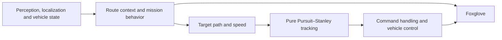

# Autonomous Driving: Decision-Making and Control

**2026 Student AI·SW Mobility Competition · Konkuk University Team K.A.I.**

Team K.A.I. completed all required missions in both the preliminary and final rounds under the competition rules. The team received two awards in the Self-built Autonomous Vehicle category:

| Division | Team award |
| --- | --- |
| Autonomous Driving Implementation | **Grand Prize — Minister of Land, Infrastructure and Transport Award** |
| Creative Technology | **Special Award** for the vehicle technical report |

| Period | Team | My role |
| --- | --- | --- |
| March–October 2026 | 27 members; decision-making subteam of 5 | FSM design, tracking-control implementation, driving-log analysis, and vehicle operation |

[Project portfolio](https://steveandy-sudo.github.io/projects/ai-sw-mobility/) · [Experiment record](docs/EXPERIMENTS.md) · [Setup](docs/PORTFOLIO_SETUP.md)

## My work

- Designed FSM states and transition conditions with teammates for traffic lights, timed stops, obstacle avoidance, and mission completion.
- Recorded GNSS route waypoints while driving and conducted trials using GNSS/IMU-based localization.
- Analyzed perception outputs, FSM transitions, planned paths, and vehicle feedback in Foxglove. Reviewed timestamps and coordinate frames, then discussed corrections with teammates.
- Operated the vehicle during Test Week experimental runs and obstacle-avoidance field tests. The avoidance tests covered approach deceleration, collision-free passage, route return, and acceleration afterward.
- Presented a Pure Pursuit–Stanley hybrid strategy at a Hyundai Mobis-sponsored symposium, then wrote and revised the ROS 2 implementation. The presentation with Woojin Hwang received the Hyundai Mobis Technical Special Award, Autonomous Driving Division, in the name of Team K.A.I.

Both competition courses reached up to **11 m/s (39.6 km/h) during venue practice**. An initial comparison on matched Gazebo segments at **6 m/s** showed approximately **14% lower heading-error p95** and **10% lower steering-command total variation** with hybrid tracking than with Stanley alone. These figures describe the initial simulation comparison; the competition outcome is the mission completion and awards above.

## Software structure



| Area | Code to read first |
| --- | --- |
| Route and mission decisions | [Planning engine](kaiev26_decision/kaiev26_decision/main_planning_engine_node.py), [stop-point FSM](kaiev26_decision/kaiev26_decision/stop_point.py), [arbiter](kaiev26_decision/kaiev26_decision/arbiter.py) |
| Obstacle avoidance | [Behavior](kaiev26_decision/kaiev26_decision/obstacle_behavior.py), [sequence](kaiev26_decision/kaiev26_decision/obstacle_sequence.py), [world representation](kaiev26_decision/kaiev26_decision/obstacle_world.py) |
| Route capture and alignment | [Route capture](kaiev26_decision/kaiev26_decision/route_capture.py), [route manager](kaiev26_decision/kaiev26_decision/route_zone_manager_node.py) |
| Pure Pursuit–Stanley tracking | [Motion controller](kaiev26_motion_control/kaiev26_motion_control/motion_control_node.py), [configuration](kaiev26_motion_control/config/motion_control.yaml) |
| Vehicle operation and recorded trials | [Operating TUI](kaiev26_decision/kaiev26_decision/operating_tui.py), [test TUI](kaiev26_decision/kaiev26_decision/test_tui.py), [readiness checks](kaiev26_decision/kaiev26_decision/test_readiness.py) |
| Cone-course brake inspection | [AEB package](kaiev26_aeb/README.md), [Stanley controller](kaiev26_aeb/kaiev26_aeb/stanley.py), [trial settings](kaiev26_aeb/kaiev26_aeb/trial_profiles.py) |
| Visualization | [Foxglove package](kaiev26_decision_fox/README.md) |

The main decision workflow publishes a target path and speed for motion control. In the TUI workflow, motion control publishes `/decision/raw_command`; the TUI relays it to `/planning/command`, followed by the external Control command governor. The cone-course brake inspection uses its own workflow.

## E-stop-controlled departure

The collected `kgm` revision implements the departure behavior identified during source selection: the vehicle waits in **E-stop PAUSE**, the operator selects AUTO, and releasing PAUSE to **RUN** permits departure. The TUI records the PAUSE/RUN transitions; the external vehicle-control system handles the physical interlock.

See [startup behavior](docs/STARTUP_BEHAVIOR.md) for the code locations and the change from `main`.

## Driving records

Recorded driving data became central to my debugging work. Following perception, decision state, and measured vehicle response together helped me locate problems and discuss corrections with teammates.

[](https://steveandy-sudo.github.io/projects/ai-sw-mobility/#real-vehicle-trials)

*Final-course waypoint driving during venue practice. The portfolio includes the driving excerpts and Foxglove views.*

## Build and documentation

Use the matching Ubuntu 22.04 / ROS 2 Humble team workspace. External packages provide the message definitions, perception, localization, vehicle control, and simulator integration.

```bash
cd ~/KAI_ws
source /opt/ros/humble/setup.bash
colcon build --symlink-install --packages-select \
  kaiev26_decision kaiev26_motion_control kaiev26_decision_fox kaiev26_aeb
source install/setup.bash
```

- [Setup and workspace dependencies](docs/PORTFOLIO_SETUP.md)
- [Runbook](docs/DECISION_RUNBOOK.md), [architecture](docs/ARCHITECTURE.md), [mission scenarios](docs/MISSION_SCENARIOS.md), [tracking](docs/ROUTE_TRACKING.md), and [parameters](docs/PARAMETER_BOOK.md)
- [Validation](docs/VALIDATION.md) and [source revision](docs/SOURCE_MAP.md)

The source packages retain their existing authorship, metadata, and license notices.
