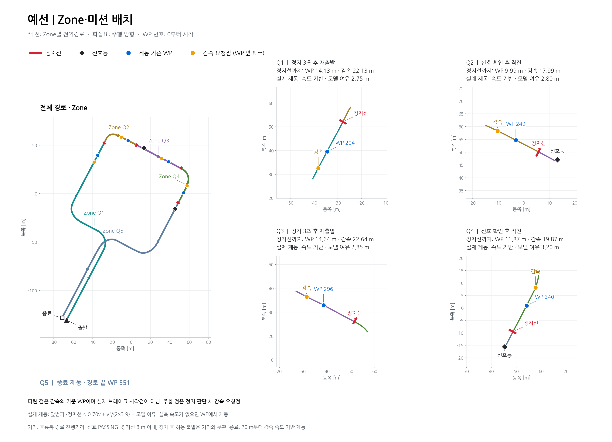
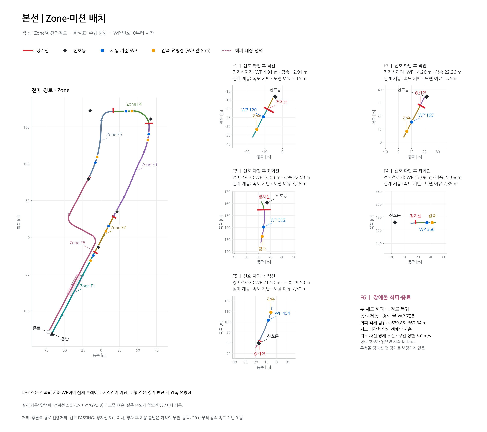

# Mission Scenarios

예선·본선의 Stage와 Event를 정리한다. 실행 기준은 `config/*_policy.yaml`이다.

## Event

| Event | 동작 |
|---|---|
| `TIMED_STOP` | 정지거리 지점에서 제동, 실제 정지 확인 후 3초 대기 |
| `SIGNAL_OBEY` | 해당 Stage의 지정 신호에 따라 정지 또는 통과 |
| `FINISH` | 종료 20 m 안에서 `0.6 m/s`로 감속, 앞범퍼가 종료선 뒤 5 m 안에 서도록 제동, 늦어도 마지막 1 m에서 정지 |

세 Event는 정지점 기계 하나(`stop_point.py`)를 함께 쓴다. Event 목록은 시작할 때 코스 Policy와 모드로 한 번 만들고, 앞 Event가 `CLEARED`가 된 뒤에만 다음 Event로 넘어간다. 완료 Event는 같은 Run에서 반복하지 않는다. 구조는 [Architecture](ARCHITECTURE.md#정지점-기계)에 있다.

그림의 색 선은 Zone, 빨간 가로선은 정지선, 검은 마름모는 신호등이다.
파란 점은 제동 WP, 주황 점은 그 WP 8 m 전 감속 시작점이며 신호 구간에서는 정지가 필요할 때만 사용한다.

## 예선



```text
R10B -> R08A -> R05A -> R06A -> R07A -> R10A
```

| Stage | 제동 WP | Event | 대상 |
|---|---:|---|---|
| `Q_STAGE_1` | `204` | `TIMED_STOP` | 정지선 `264` |
| `Q_STAGE_2` | `249` | `SIGNAL_OBEY` | 정지선 `058`, 신호 `318`, 직진 |
| `Q_STAGE_3` | `296` | `TIMED_STOP` | 정지선 `341` |
| `Q_STAGE_4` | `340` | `SIGNAL_OBEY` | 정지선 `048`, 신호 `144`, 직진 |
| `Q_STAGE_5` | - | `FINISH` | WP `551` |

예선 Q1~Q4의 정지선→제동 WP 거리는 각각 `13.37 / 9.69 / 13.80 / 10.67 m`다.
감속 요청은 각 WP 8 m 전이며, Q2/Q4는 정지가 필요한 신호일 때만 적용한다.

### 어린이보호구역 속도

- 1017 시나리오: 예선 6번 우회전 뒤 ~ 7번 신호 직진 ~ 8번 우회전 전, `30 km/h` 이하, 초과 시 1분 페널티다.
- 설정 위치: `config/qualifying_policy.yaml`의 `speed_zones`(`SCHOOL_ZONE`)다.
- 구간: 진행거리 `331.5 ~ 404.6 m`다. 지도 빨간 노면 `road_surface_manual_162`(`333.5 ~ 402.6 m`)에 앞뒤 2 m를 더했다.
- 정지선 `048`(`351.8 m`)이 구간 안에 있다.
- 상한: `7.5 m/s`(`27 km/h`)다. 10/17 목표 7.0 m/s에서 실제 최고 7.27 m/s였다.
- 상한은 앞범퍼가 시작점에 닿을 때 적용하고, 후륜축이 끝점을 지나면 푼다.
- 목표속도만 낮추고 제동은 하지 않는다. 시작점 전에는 `0.5 m/s²` 사전 감속 상한을 둔다.
- 중재기의 `speed_zone` 모듈이 상한만 낸다. 정지 요청은 쓰지 않는다.
- 제약 표시: `SPEED_ZONE_PRE_SLOW:SCHOOL_ZONE`, `SPEED_ZONE_CAP:SCHOOL_ZONE`이다.
- 본선에는 두지 않는다.

## 본선



```text
R10B -> R04B -> R02A -> R09A -> R12B
     -> R11B -> R05B -> R01B -> R04A -> R10A
```

| Stage | 제동 WP | Event | 대상·진행 |
|---|---:|---|---|
| `F_STAGE_1` | `120` | `SIGNAL_OBEY` | 정지선 `052`, 신호 `142`, 직진 |
| `F_STAGE_2` | `165` | `SIGNAL_OBEY` | 정지선 `057`, 신호 `143`, 직진 |
| `F_STAGE_3` | `302` | `SIGNAL_OBEY` | 정지선 `209`, 신호 `305`, 좌회전 |
| `F_STAGE_4` | `356` | `SIGNAL_OBEY` | 정지선 `214`, 신호 `375`, 좌회전 |
| `F_STAGE_5` | `454` | `SIGNAL_OBEY` | 정지선 `221`, 신호 `322`, 직진 |
| `F_STAGE_6` | - | 장애물 + `FINISH` | 두 세트 회피, 복귀, WP `728` 정지 |

본선 F1~F5의 정지선→제동 WP 거리는 각각 `4.24 / 13.52 / 13.77 / 16.22 / 20.74 m`다.
정지가 필요한 신호일 때 각 WP 8 m 전부터 감속을 요청한다.

- 제동 WP 번호는 0-based이며 Zone 경계와 구분한다. 
- 보정된 지도에서 제동 WP 도달 시 앞범퍼 여유는 예선 약 `7.54~11.61 m`, 본선 약 `2.08~18.59 m`다. 정지 완료 후 여유가 아니다.
- 장애물 회피는 본선 `F_STAGE_6`에서만 활성화된다. 
- `F_STAGE_6`(F5 정지선~결승, 신호 없음)은 TUI 속도 대신 `course_speed_mps=13.0`으로 달린다(2026-10-24, fsm `FINAL_SPRINT`). 곡선 F3·F4 상한, 장애물 구간 사전감속·상한, 결승 정지는 그대로 그 아래로 누른다.
- 장애물 구간 속도 상한은 `5.0 m/s`다(2026-10-16 결정 D10은 `3.0`, 2026-10-23 미단 회피 성공 값으로 올림). 구간은 본선 WP 640부터 WP 670까지 양 차로를 덮는 다각형이고(경로 기준 `639.85~669.84 m`, 결정 D14, 범위는 2026-10-16 kgm 결정) `config/final_policy.yaml`의 `obstacle_zone`에 있다. 드럼 열은 경로 656 m와 662 m에 있다. 속도 상한은 앞범퍼가 WP 640(`start_route_s=639.85 m`)에 닿을 때부터이고, 차가 구간 끝을 지나고 확정한 회피 경로가 복귀점까지 돌아온 뒤에 풀린다. 그다음은 코스 속도다. 구간 끝 + 복귀 12 m(681.8 m)가 결승 제동점(733.5 m, 측량한 결승선 + 안테나 2 m)보다 앞이어야 하고, 이 조건이 깨지면 판단이 시작하지 않는다(D18). 다각형 밖 객체는 회피에 쓰지 않고, 구간 안의 차선 한계는 지도 차선 경계에서 읽는다. 그 앞에서는 구동도 브레이크도 없이 실측한 감속 `pre_slow_decel_mps2=0.5 m/s²` 포락선으로 상한을 내려, 굴러가기만 해도 앞범퍼가 `5.0 m/s`로 들어가게 한다. 판단의 일반 감속 `1.4 m/s²`로 잡으면 실차는 그만큼 줄지 못해 구간에 더 빠르게 들어간다. 목표만 낮추고 브레이크는 걸지 않는다. 회피 경로는 한 번 확정한 뒤 새 열이 보이거나 여유가 깨질 때만 다시 계획하고, 인지가 끊겨도 확정 경로를 `5.0 m/s`로 따른다. 회피 경로는 Stanley만으로 따른다(PP 비율 `0`). 계획이 전혀 없을 때의 대체 주행은 `1.6 m/s`다.
- 2026-10-17 실측 배치(`records/20261017_114251_*`)는 드럼 줄이 `s=649.6`, `654.0`으로 `4.4 m` 간격이고, 경로 기준 각각 좌 `1.2 m`, 우 `0.9 m`다. 회피 경로는 차선 한계 안에서 여유가 가장 큰 S자를 고르고 속도는 그 여유를 따른다([Parameter Book](PARAMETER_BOOK.md#장애물-회피)). 시나리오는 `test/scenarios/obstacle_zigzag_tight.yaml`이다. 지도 차선을 쓰는 이 구조에서 좌-우 순서는 중앙선 쪽 허용을 써서 목표 여유 `0.50 m` 경로가 나와 `3.0 m/s`로 지나고 측정 최소 여유는 `0.37 m`다. 우-좌 순서는 `0.23 m`, 상한 약 `2.3 m/s`다(2026-10-19, 이전 구조는 좌-우 `0.10 m`, main 구조는 best-effort로 `0.29 m`, `1.6 m/s`).
- 중앙선 쪽은 어느 열이든 차선 한계보다 `0.5 m` 더 나갈 수 있고 연석 쪽은 넘지 않는다. 각 열은 열린 쪽으로만 지난다(결정 D13).
- 객체의 절대 위치와 첫 세트 좌우 순서는 고정하지 않는다.

## 정지선 판단

- 카메라에서 정지선을 발견해 멈추는 방식이 아니다.
- 전역경로 진행거리로 앞범퍼와 지도 정지선 사이를 재고, 그 거리가 `d_stop(v) + 여유` 이하가 되면 제동한다(정지거리 지점).
- 현재 Stage의 **제동 WP**는 사전 감속 시작점(WP 8 m 전)만 정한다. WP에서 제동하지 않는다. WP는 계획 속도에 맞춰 놓여 있어, 느리게 들어오면 WP에서 제동할 경우 정지선보다 한참 앞에 선다(2026-10-15 Gazebo F4, 5 m/s 접근에서 도색선 7.4 m 앞). 차량 속도가 끊기면 입력 끊김 규칙이 정지를 맡는다.
- 여유는 Policy 이벤트의 `brake_margin_m`이다. 예선 Q1, Q3, Q4는 `2.0 m`, Q2는 `2.5 m`, 본선 F2는 `1.0 m`, F3는 `2.5 m`, 나머지는 `1.5 m`다. 앞범퍼가 지도 정지선보다 예선은 약 3 m, 본선은 약 2~2.5 m(F3는 약 3 m) 앞에 서도록 잡았다(2026-10-15). 카메라 재생으로 본 실제 도색선이 지도와 1~2 m 다를 수 있고, Q2, F3, F5는 정지 중에도 신호등이 화면 안에 있어야 해서다. 값이 없는 이벤트는 노드 기본값 `stopline_brake_margin_m=1.0`을 쓴다.
- `d_stop(v) = 0.70 v + v² / (2 × 3.9)`이고 `v`는 실측 속도다. 10/11 실차 제동 맞춤값이며 수치는 [Parameter Book](PARAMETER_BOOK.md#정지신호)에 있다.

`TIMED_STOP`
- 제동 WP 8 m 전에 한번에 목표 2.0 m/s를 요청하고, WP를 지난 뒤에도 정지거리 지점까지 이어간다.
- 정지거리 지점에서 목표 0과 브레이크 체결을 요청한다. 
- 실제속도 0.1 m/s 이하를 확인한 뒤 3초를 세고 재출발한다.
- 신호등 상태는 이 Event의 정지 여부에 영향을 주지 않는다.

## 신호 판단

신호 Event는 자기 `traffic_light_ids`의 신호등만 읽는다. 후륜축이 정지선을 넘어 Route가 다음 Stage의 정지선과 신호등을 가리켜도, 진행 방향도 그 Event의 것으로 본다(2026-10-16 결정 D5). 아래 표는 **`COMMITTED` 확정 전**의 판단이다.

| 입력 | 직진 Event | 좌회전 Event |
|---|---|---|
| `GREEN` | 진행 | 정지 |
| `GREEN+ARROW` | 진행 | 진행 |
| `RED` | 정지 | 정지 |
| `YELLOW` | 정지 | 정지 |
| `RED+ARROW`, `ARROW` | 정지 | 진행 |
| `UNKNOWN` | 정지 | 정지 |

- 입력은 자기 신호등의 정렬된 현시표이고, 카메라는 예정 변경 전후 1초 안에서 판단하거나 확실한 반대를 볼 때 현시표를 거부한다. 현시표가 없거나 정렬되지 않았으면 카메라로 판단한다([Parameter Book](PARAMETER_BOOK.md#현시표-판단)).
- 진행 허용 신호를 0.4초 연속 확인한다. 제동 중에도 확인하며, 불허 신호면 타이머를 초기화한다. 확인 중 `0.3초`(`signal_unknown_before_permission_grace_sec`) 이하의 UNKNOWN은 확인을 멈추기만 하고 처음부터 다시 세지 않는다. 더 길면 초기화하고, 화살표 꺼짐은 바로 초기화한다. UNKNOWN은 허용이 아니다(2026-10-17 145703 F2).
- 달리는 중에 본 허용 신호는 정지선 8 m 안에서만 `COMMITTED`를 확정한다. 8 m 밖에서 본 허용 신호는 통과를 확정하지 않는다. 이후 적색으로 바뀌면 정지하고, 황색이나 UNKNOWN은 아래 정지거리 판단을 따른다.
- 현시표(정렬된 현시 추정)가 허가하고 허가가 끝나는 시각을 알면, 제동점(느린 차가 8 m 확정 거리에 먼저 닿으면 그곳)에 처음 닿는 틱에 통과와 정지를 한 번 정한다. 앞범퍼가 정지선에 닿는 시간(앞범퍼 거리 / 속도)에 `signal_arrival_margin_sec`(1초)를 더해도 허가가 남으면 그 자리에서 `COMMITTED`를 확정하고, 아니면 허가를 이번 접근에서 버리고 적색처럼 그 제동점에서 제동한다. 정한 뒤에는 바꾸지 않는다. 허가 끝을 모르면(현시표 없음, 불신, 카메라 전용) 위의 8 m 규칙대로다(2026-10-20 Gazebo F3 g98.5: 화살표가 4초 남은 29 m 앞에서 서지 않고 황색에 정지선을 넘었다).
- 정지한 뒤 허용 신호로 출발하면 정지선까지 거리와 관계없이 출발하는 그 틱에 `COMMITTED`를 확정한다. 110초 UNKNOWN 출발과 선을 넘어 멈춘 뒤의 출발도 같다. 같은 Event로는 다시 제동하지 않는다(2026-10-16 결정 D4). F5처럼 여유가 8 m보다 큰 정지선에서 굴러가다 신호를 놓쳐 다시 급제동하던 경우를 없앤다.
- 진행 허용을 확인한 뒤 황색이나 UNKNOWN으로 바뀌었을 때 앞범퍼와 정지선 사이가 `d_stop(v)`보다 짧으면 정지선 전에 설 수 없으므로 `COMMITTED`를 확정한다.
- 이 판단은 허용 신호 바로 다음 신호에만 쓴다. 그 사이 적색이나 황색이 한 번 들어오면 쓰지 않는다. 적색은 거리와 관계없이 바로 제동한다. 화살표 이벤트에서 화살표만 꺼진 적색은 아래처럼 `0.3초` 뒤에 제동한다.
- 진행 허용을 확인한 뒤 들어온 UNKNOWN은 `0.3초` 동안 허용 신호로 본다. 그보다 길게 이어지면 정지 신호로 본다. 허용 확인 전의 UNKNOWN은 정지 신호다.
- 화살표 이벤트에서 화살표 허용을 확인한 뒤 원형 등만 읽히고 화살표가 꺼진 경우(적색이나 녹색만 읽힘)도 `0.3초` 동안 허용 신호로 본다. UNKNOWN과 화살표 꺼짐이 섞여 이어지면 한 타이머로 센다. 2026-10-15 Gazebo F4에서 PV26 화살표 점수가 0.5 근처에서 흔들려 정지와 재출발을 되풀이한 데 따른 것이며, 판단파트장 확인 전이다.
- 정지선에 선 채 UNKNOWN만 `110초` 이어지면 출발한다. 적색, 황색, 녹색 등 유효한 신호가 한 번이라도 들어오면 처음부터 다시 센다. 출발할 때 경고 로그와 `/diagnostics`에 Event, 정지선, 대기 시간을 남긴다.
- `COMMITTED` 확정 후, 해당 Event의 황색·적색·UNKNOWN으로 신호 정지를 재요청하지 않는다.
- 8 m는 후륜축 경로 진행거리 기준이며, 황색 3초 안에 교차로 통과나 시야 소실을 보장하지 않는다.
- 좌회전은 화살표가 활성화되고 Policy 이벤트의 `arrow_maneuver`가 `LEFT`일 때만 허용한다. Route의 maneuver는 보지 않는다.

| 신호 변경 상황 | 동작 |
|---|---|
| 허용 신호 → 적색, `COMMITTED` 전 | 정지 대상으로 판단. 제동 WP 8 m 전부터 2.0 m/s, 정지거리 지점에서 0 + brake. 화살표 이벤트에서 화살표만 꺼진 적색은 `0.3초` 이어진 뒤부터 정지 신호 |
| 허용 신호 → 황색, UNKNOWN, `COMMITTED` 전 | 앞범퍼와 정지선 사이가 `d_stop(v)`보다 짧으면 `COMMITTED` 확정, 아니면 적색과 같이 정지. UNKNOWN은 `0.3초` 이어진 뒤부터 정지 신호 |
| 적색·황색 → 허용 신호, 브레이크 체결 전 | 허용 신호 0.4초 확인 후 감속 해제, 기존 순항 목표로 재가속 |
| 브레이크 체결 후 허용 신호 | 실제 정지와 허용 신호 0.4초 연속 확인 후 해제·재출발하며 `COMMITTED` 확정. 3초 대기 없음 |
| `COMMITTED` 확정 후 신호 변경 | 해당 신호 정지를 다시 요청하지 않고 기존 경로·속도계획으로 통과 |
| 인지 끊김 | 자기 신호를 UNKNOWN으로 본다. `COMMITTED` 확정 뒤에는 영향이 없다. RECOVERY로 가지 않는다(결정 D3) |

- `COMMITTED` 전에 정지할 수 있는 거리라면 적색과 황색에 같은 정지 동작을 사용한다. 
- 정지거리 지점을 지난 뒤 `COMMITTED` 전에 적색을 받으면 현재 위치에서 바로 `0 + brake`를 요청한다. 고속에서는 정지선 전 정지를 보장하지 않는다.
- 제동 WP는 지났지만 정지거리 지점 전에 적색을 받으면(느리게 들어올 때) 그 지점까지 2.0 m/s로 다가간 뒤 제동한다. 2026-10-15 전에는 WP를 지난 뒤면 바로 제동했다. 판단파트장 확인이 필요하다.
- 앞범퍼가 선을 조금 넘었어도 신호가 보이면 정지한다.
- 후륜축 진행도가 지도 정지선을 지났고 차량이 정지했으며 자기 신호등이 `UNKNOWN`이면, 신호 현시 추적기(`/planning/traffic_signal_phases`)가 그 신호등을 `aligned`로 내는 동안 그 `permitted_now`를 신호로 쓴다(허용이면 녹색이나 화살표, 아니면 적색). 정렬된 추정이 없거나 0.5초보다 오래됐으면 자기 신호등이 1초간 `UNKNOWN`일 때 교차로 고립 방지를 위해 통과한다. 다음 교차로 신호는 이 판단에 쓰지 않는다. 110초 UNKNOWN 출발은 그대로다.
- 신호 정지로 서 있는(`HELD`) 동안에는 정지선 앞이든 넘어서든, 자기 신호등 인지가 진행 허용(녹색이나 화살표)이어도 신호 현시 추적기가 자기 신호등 가운데 하나를 `aligned`로, `permitted_now`를 거짓으로 내면 출발하지 않는다. 추정은 0.5초 안의 것만 본다. 적색인데 pv26이 화살표를 읽는 경우(Gazebo F4 신호등 375, 실차 F3 신호등 305)를 막는다(2026-10-16 kgm 결정). 추적기가 허용으로 바뀌거나, 정렬이 풀리거나, 추정이 0.5초보다 오래되면 원래 판단으로 돌아가며 허용 신호 0.4초 확인을 처음부터 다시 거친다. 추적기는 여기서 출발을 막기만 하고 허락하지는 않는다. 접근 중 판단(제동, 정지 없는 통과, 황색 딜레마)과 출발 뒤 `COMMITTED`는 바뀌지 않는다. 막는 동안 `SIGNAL_PHASE_TRACKER_BLOCK` 제약과 사유 문구를 내고, 막기 시작할 때마다 경고 로그와 `/diagnostics`를 남긴다. 추적기는 원형 등화로만 주기 위치를 맞추므로 거짓 화살표가 이어져도 정렬이 풀리지 않고, 화살표 허용은 지도 프로그램의 화살표 구간이 와야 낸다([Parameter Book](PARAMETER_BOOK.md#신호-현시-추정)).
- 제동 중 연속 유지된 허용 신호 시간은 인정하되, 실제 정지 전에는 브레이크를 해제하지 않는다.
- 인지가 끊겨도 RECOVERY로 가지 않는다. `COMMITTED` 확정 뒤에는 그대로 통과하고, 확정 전이면 UNKNOWN과 같이 판단한다. 전역경로 정합이나 차량 상태가 끊길 때만 입력 끊김 규칙(속도 0, 1초 뒤 브레이크)을 쓴다.

## 정지·재출발

```text
Event 선택: 정지선 30 m 전(F5는 40 m)
  -> 제동 WP 8 m 전: 목표 2.0 m/s 즉시 요청, 이 구간만 명령 감속 상한 10.0 m/s²
  -> 정지거리 지점(앞범퍼 기준 d_stop(v) + brake_margin_m): speed=0, brake_engage=true
  -> 실제속도 <= 0.1 m/s 확인
  -> TIMED_STOP은 3초 대기, 신호 정지는 진행 신호 확인 후 출발(3초 대기 없음)
  -> brake=false로 0.8초 대기
  -> 2.0 m/s²로 5.0 m/s까지, 이후 1.0 m/s²로 순항속도까지 가속
```

- 감속 시작 8 m는 **제동 WP 기준**, `COMMITTED` 8 m는 **정지선 기준**이다.
- 일반 추종·코너의 명령 감속 상한은 기존 `2.0 m/s²`를 유지한다. 장애물 회피의 비정지 감속 명령은 `10.0 m/s²`다.
- 이미 브레이크가 체결됐으면 허용 신호가 들어와도 실제속도 `0.1 m/s` 이하 확인 + 브레이크 해제 대기 `0.8초`는 유지한다. 
- 브레이크를 요청한 뒤에는 차가 움직이는 동안에도 조향 목표를 측정 조향각으로 둔다. 실차는 브레이크 요청과 함께 KEYA가 꺼지므로 바퀴가 그 자리에 머물고, Gazebo도 같게 움직인다. 2026-10-16 전에는 거리 0이 조향 축소를 0으로 만들어 Gazebo에서 바퀴를 폈다.
- 명령 상한은 실제 차량 감속도를 보장하지 않는다.
- 정지점 기계가 `BRAKING`이나 `HELD`인 동안(신호 정지, 3초 정지의 제동과 대기, 결승 정지)은 입력이 끊겨도 기계를 그대로 두고 정지 요청(`need_stop`, 목표 0, 거리 0)을 계속 낸다. 끊김 때문에 걸린 브레이크가 풀리지 않는다. 장애물 행동은 정지 요청을 낼 수도 지울 수도 없으므로 결승 구간이 장애물 구간 안이어도 같다.
- 결승 제동이 걸린(`BRAKING`, `HELD`) 뒤 후륜축이 경로 끝을 넘어 경로 투영만 끊기는 것은 설계한 초과 주행(`finish_overrun_m`)이라 입력 끊김으로 보지 않는다. `RECOVERY`로 바꾸지 않고 `FINISH`의 `BRAKING`에서 `HELD`로 간다(사유 `finish brake held past the route end`). 다른 입력 문제가 섞이면 전처럼 입력 끊김이다(2026-10-20 Gazebo: 매 완주 2.5~2.7 s `RECOVERY`).
- 결승 제동이 회피 경로 복귀 전에 시작되면 회피 경로를 유지한 채 제동한다(결정 D18).
- 완료 정의는 판단의 결승 정지 하나다(결정 D11). 결승 정지점 기계가 `HELD`(실제속도 `0.1 m/s` 이하)가 되면 판단이 `/planning/behavior_decision` 제약에 `FINISH_HELD`를 붙인다. 시험 TUI는 이 제약을 받으면 Run을 완료로 끝낸다. 예전의 후륜축 1 m, 브레이크, 1초 조건은 쓰지 않는다.

## 시험 Case

| TUI Case | 기능 |
|---:|---|
| `1` | 미션 실행: 선택 코스의 모든 미션 |
| `2` | 전역경로 추종: 목표속도만 입력 |
| `3` | 수동주행 경로 수집·등록 |
| `4` | 장애물 회피: 수집 경로를 선택했을 때만 표시 |

- `P`로 경로를 선택한다.
- Case `1`은 Policy대로 정지선·신호를 구분하고 본선 회피도 실행한다.
- 수집 경로는 미션 Policy가 없으므로 Case `2~4`만 지원한다.
- `decision.launch.py`는 Case 선택 없이 예선·본선 Case `1`과 같은 미션을 실행한다.
- 운용 화면에서는 코스·속도만 설정하며 녹화하지 않는다.

## 변경 위치

| 변경 대상 | 파일 |
|---|---|
| 전역경로·종료점 | `waypoints/kcity_*_route.yaml` |
| 정지선과 신호등 위치 | 지도 semantics (`config/*_landmarks.yaml`의 `map_semantics`) |
| Stage·Event·제동 WP | `config/*_policy.yaml` |
| 감속·정지·회피 수치 | `config/decision_pipeline.yaml` |
